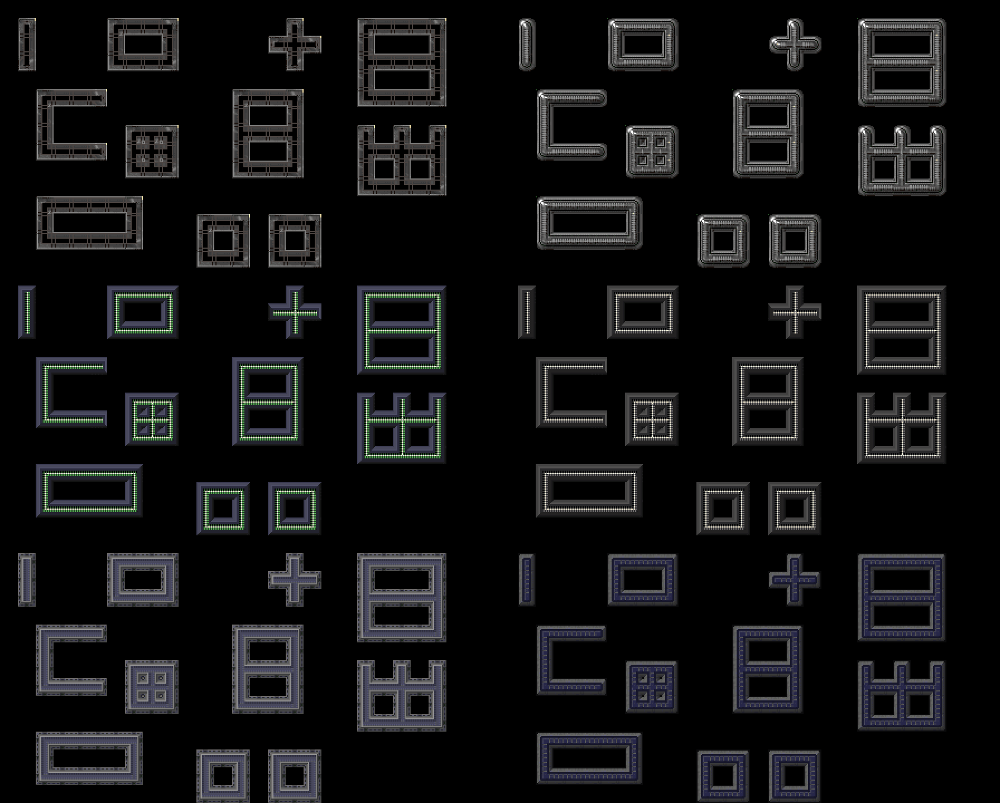

# Tile layout ("tile roles")

A Continuum tileset is the BMP at the start of a `.lvl`: 19 × 10 tiles of 16 px (304 × 160, 8-bit).
Map tile values 1–190 point into it: slot = value − 1, column = slot % 19, row = slot // 19.
Values 162–190 are doors, flag, safe zone, goal, fly-over and fly-under: never wall pieces.

The **tile layout** says which slot is which piece of a wall, so tools (map generation, the
tile editor, tileset drawing) can build walls that run in a continuous line, turn properly,
join at T-junctions and crosses, and end properly.

The layout lives in one file: [`src/Dare.Arenas/Web/wwwroot/tile-layout.json`](../src/Dare.Arenas/Web/wwwroot/tile-layout.json),
served at `/arena/tile-layout.json`. Replace that file to change the standard; no code reads
slot numbers from anywhere else.

## Roles: a piece is defined by its open edges

An edge is **open** when the wall continues into the neighbouring cell on that side
(N up, E right, S down, W left), **closed** when the wall's outline runs along it.
Every combination of open edges is one role, 16 in all:

| role | open | piece |
|---|---|---|
| `single` | – | stand-alone block |
| `end-left` / `h-mid` / `end-right` | E / EW / W | horizontal bar |
| `end-top` / `v-mid` / `end-bottom` | S / NS / N | vertical bar |
| `corner-tl` `corner-tr` `corner-bl` `corner-br` | ES / SW / NE / NW | turns |
| `edge-top` `edge-left` `edge-right` `edge-bottom` | ESW / NES / NSW / NEW | T-junctions (the edges of a box) |
| `fill` | NESW | cross, or the inside of a box |

To place a wall cell, look at its four neighbours, write down the sides that are wall too,
and use the role whose `open` is that set. Tools must match on `open`, never on role names:
a replacement layout may name its roles differently.

In "box" styled packs (all of tactical2's) the T pieces are drawn as the straight edges of a
thick block and `fill` as its inside, so a 3 × 3 block of wall reads as a framed plate, and a
one-cell line through a junction still joins cleanly.

## A pack

One tileset holds several **packs**: a full set of the 16 roles in one style. In tactical2
every pack is a 4 × 4 block (`packTemplate`):

```
single     end-left   h-mid      end-right
end-top    corner-tl  edge-top   corner-tr
v-mid      edge-left  fill       edge-right
end-bottom corner-bl  edge-bottom corner-br
```

| pack | origin (col,row) | tiles |
|---|---|---|
| `grey-plate` | 1,0 | 2–5, 21–24, 40–43, 59–62 |
| `grey-round` | 5,0 | 6–9, 25–28, 44–47, 63–66 |
| `green-lit` | 9,0 | 10–13, 29–32, 48–51, 67–70 |
| `white-lit` | 13,0 | 14–17, 33–36, 52–55, 71–74 |
| `steel-blue` | 5,4 | 82–85, 101–104, 120–123, 139–142 |
| `navy` | 9,4 | 86–89, 105–108, 124–127, 143–146 |

Each pack built into sample walls by `TileLayout.pick` (pick by neighbours, nothing else):



The rest of the sheet is listed under `other` (decor that is not a full pack) and `reserved`.

## The file

```jsonc
{
  "format": "dare-tile-layout", "version": 1,
  "name": "…",
  "tileset": { "columns": 19, "rows": 10, "tileSize": 16 },
  "roles": { "<role>": { "open": "NESW subset", "label": "…" } },   // required
  "packTemplate": { "size": [4, 4], "cells": { "<role>": [col, row] } }, // optional
  "packs": [ { "id": "…", "name": "…", "origin": [col, row],          // origin optional
               "tiles": { "<role>": tileNumber },                     // required, explicit
               "interior": tileNumber } ],                            // optional, see below
  "other": [ { "tile": n | "tiles": [n…], "label": "…" } ],            // optional
  "reserved": { "from": 162, "to": 190, "label": "…" }                 // optional
}
```

Rules a reader can rely on (checked by `TileLayout.parse` in
[`tiles.js`](../src/Dare.Arenas/Web/wwwroot/tiles.js); tests: `node --test tests/js/*.test.js`):
- every pack lists its tiles explicitly; `packTemplate` is only a convenience for editors;
- each `open` is a subset of `NESW` and no two roles share the same set;
- tile numbers are 1–161, outside `reserved`, and no tile is in two packs;
- a pack may leave roles out (a partial pack); tools fall back as below;
- `interior`, when given, follows the same tile rules and is not a role (it has no `open` set).

**Interior** (optional, per pack): a plain piece for a cell whose eight neighbours, diagonals
included, are all wall: the inside of a thick wall. `fill` stays the piece for crosses and the
edge of a fill area; packs whose `fill` is decorated (all of tactical2's carry a stud or pyramid)
would otherwise turn a thick wall into a waffle. Same checks as pack tiles (1–161, not reserved,
in no other pack or role). Tools that don't know it, or packs without it, use `fill`.

**Fallbacks** when a pack lacks the exact role: drop open edges, fewest first, and take the
first role that exists; among two-edge pieces a straight bar comes before a corner, so a missing
T keeps the line running through. Else `single`, else `fill`.
`TileLayout.pick(layout, packId, openSet)` implements this.

## The tile editor

The Tile Editor tab of the arena editor (`/arena/me#tiles`) and the page `/arena/tiles`
(`?arena=<name>` or `?map=<ready-made>.lvl` opens one) both mount `tile-studio.js`
(`TileStudio.mount(el, { arena })`; shared code in `tiles.js`, styles in `tiles.css`).

- **Open** the arena's current map tileset, one of Your tilesets, a map in Your maps, a ready-made
  map, a `.lvl`/`.bmp`/`.bm2`, or a `.png` (reduced to 256 colours).
- **Draw**: pencil and eraser (brush 1–8), line, rectangle and ellipse (outline or filled; Shift
  for 45° and squares), fill, replace colour, colour picker (or Alt+click), two colours (right
  click draws the second), mirror ↔/↕ inside a tile. Strokes stay inside the selection, or inside
  the tile in tile view.
- **Select** a rectangle: drag to move it, copy/cut/paste (the selection, or the whole tile),
  flip and rotate, arrows nudge, colour 0 optionally see-through. Flipping a whole tile can move
  its role with it (corner-tl → corner-tr).
- **Views**: whole sheet or one tile with its neighbours (Tab), zoom, pixel and tile grids, full
  screen. **Seams**: the tile repeated 3 × 3; **How the pack joins**: walls built from the pack.
- **Palette**: pick, change a colour everywhere, flash its uses, take another tileset's palette
  (pixels move to the nearest colour). Colour 0 is empty space.
- **Reference**: an image under or over the art, and the tileset as opened, faintly.
- **Roles** (the slot panel and Packs): set by hand, new pack from the template, Check edges,
  Roles from edges, load a role map, back to the standard.
- **Undo/redo** cover pixels, palette and roles. Keys are listed under Keys.
- **Keep**: Your tilesets (`/arena/api/tilesets`: list, file, roles, save, rename, duplicate,
  remove; 25 per pilot; BMP 304 × 160 8-bit plus the role map). Downloads: `.bmp`, `.lvl`, roles.
- **Use it in a map**: put the tileset into the arena's current map (a new map in Your maps) or
  into a map already in Your maps. Its walls and eLVL data are kept. Either way it is a draft:
  the arena changes only when that map is Applied on the Map tab or Published from the map editor.

## Role maps for one tileset

The tile editor (`/arena/tiles`) saves a **role map** for a given tileset in the same format,
so a tileset whose packs sit in other slots is described by its own file and every tool that
reads a layout reads it too.

## Replacing the standard

Write your own file in this format and put it at `src/Dare.Arenas/Web/wwwroot/tile-layout.json`
(or load it in the tile editor with "Load layout"). Role names, pack ids and positions are
all data; only the `open` sets carry meaning.
